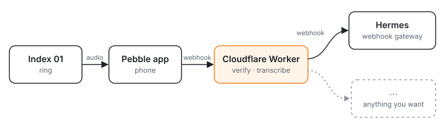

# transcription-router

A Cloudflare Worker that receives the [Index 01](https://github.com/coredevices/mobileapp/blob/main/experimental/src/commonMain/kotlin/coredevices/ring/external/indexwebhook/INDEX_WEBHOOK_API.md) ring's webhook, transcribes the recording with Whisper, and does something with the text. Out of the box it forwards the transcript as a signed webhook to [Hermes](https://github.com/NousResearch/hermes-agent), which acts on it in the background.

- Checks the Index HMAC signature and timestamp, and answers test events.
- Transcribes with `openai/whisper-large-v3-turbo` on OpenRouter. Swapping in Workers AI's Whisper is a few lines.
- Forwards `{ transcript, recorded_at, trigger, delivery }`, signed in Hermes's V2 webhook scheme. Any receiver that checks an HMAC can take it.
- Answers 502 when a step fails, so the Index app retries the delivery.

Built with [Effect](https://effect.website) and [effect-cf](https://www.npmjs.com/package/effect-cf) on Cloudflare Workers.

## Make it yours

Fork it, then tell your coding agent:

> Follow SETUP.md.

The agent asks what should happen to your transcripts, edits the block marked "What happens to the transcript" in `src/index.ts`, sets the secrets, deploys, and walks you through connecting the Index app.

## License

MIT
